# ICTAK – Architecture (approved design)

```
Browser (React/Vite/Tailwind) ──► nginx (SPA + /api proxy) ──► Flask/gunicorn ──► MongoDB Atlas
        └──────────────────────── Docker containers ───────────────────────┘        (hosted)
```

Backend layering: **routes** (thin: parse, authorise, serialise) → **services** (business rules, transactions)
→ **models** → **odm** (data layer over PyMongo). Cross-cutting: `permissions/` (role + scope guards), `utils/` (envelope, errors, audit).
Storage will sit behind a `StorageBackend` interface (local now, S3-compatible later).

## Decisions
- Individual projects by default; teams optional via `project_students` (1..N).
- Mentor scope is batch-level (`batch_mentors`) with optional per-project override (`projects.mentor_id`).
- Domain leads are many-to-many (`domain_leads`) for co-leads and cross-domain grants.
- Project **stage** (state machine) is separate from the four weekly **reviews** (independent records).
- Progress weights (configurable): SRS 20 · GitHub 5 · Scrum 25 · Reviews 40 · Final sign-off 10.
- API docs: flask-smorest (OpenAPI at `/api/openapi.json`, UI at `/api/docs`).
- Out-of-scope resource access returns 404, not 403.

## Database (MongoDB)

- **One collection per model**, named as in the diagram below (lower case). `_id` is an integer taken from the
  `_counters` collection, so API URLs and links are plain numbers. Related data is **referenced by id, not embedded**:
  the data is queried from many directions, and this kept ids and API payloads unchanged when the app moved from MySQL.
- **Data layer (`app/odm`)** rather than an off-the-shelf ODM, because the services rely on a unit of work: change
  tracking, one transaction per request, locks, and delete rules.
  - A query reads one collection; related filters are sub-queries (`in_(query)`). Ordering by a referenced field uses
    `$lookup` (`order_by_related`).
  - Relationships load lazily, in batches for all loaded objects of a model; `prefetch()` loads them up front.
  - An identical read repeated with no write in between is answered from the request's cache.
- **Transactions** start at the first write or lock and end at `commit()`, so the cluster must be a replica set (every
  Atlas cluster is). MongoDB does not queue writers: of two colliding transactions one fails at once and its request is
  replayed (`odm/retry.py`), unless it had already committed something.
- **60-second limit:** a flush writes each collection in one command, and bulk operations (student enrolment and import,
  allocation, task upload) avoid per-row round trips. Portal sync commits each batch and student separately.
- **Integrity:** `ondelete` rules (cascade / set null / restrict) are applied by the application, so change data through
  the app. Unique keys are indexes. Collections use a case-insensitive collation.
- **Schema:** `flask init-db` creates collections and indexes. There are no migrations; code must read documents that
  lack a newly added field.

## Data model

```mermaid
erDiagram
    ROLES ||--o{ USERS : has
    USERS ||--o| STUDENTS : profile
    USERS ||--o| MENTORS : profile
    USERS ||--o{ DOMAIN_LEADS : leads
    DOMAINS ||--o{ DOMAIN_LEADS : "led by"
    ORGANISATIONAL_UNITS ||--o{ OU_CUSTOM_FIELDS : defines
    ORGANISATIONAL_UNITS ||--o{ BATCHES : owns
    DOMAINS ||--o{ BATCHES : "assigned to"
    BATCHES ||--o{ BATCH_OU_DETAILS : "field values"
    OU_CUSTOM_FIELDS ||--o{ BATCH_OU_DETAILS : for
    BATCHES ||--o{ STUDENTS : contains
    BATCHES ||--o{ BATCH_MENTORS : has
    MENTORS ||--o{ BATCH_MENTORS : assigned
    DOMAINS ||--o{ PROBLEM_STATEMENTS : categorises
    PROBLEM_STATEMENTS ||--o{ PROBLEM_STATEMENT_DATASETS : has
    PROBLEM_STATEMENTS ||--o{ PROBLEM_STATEMENT_DOCUMENTS : has
    BATCHES ||--o{ PROJECTS : hosts
    PROBLEM_STATEMENTS ||--o{ PROJECTS : "allocated as"
    MENTORS ||--o{ PROJECTS : "optional override"
    PROJECTS ||--o{ PROJECT_STUDENTS : team
    STUDENTS ||--o{ PROJECT_STUDENTS : member
    PROJECTS ||--o{ PROJECT_ASSIGNMENTS : history
    PROJECTS ||--o{ SRS_SUBMISSIONS : has
    SRS_SUBMISSIONS ||--o{ SRS_REVIEW_HISTORY : reviewed
    PROJECTS ||--o| PROJECT_GITHUB_REPOSITORIES : repo
    PROJECTS ||--o{ PROJECT_REVIEWS : "weeks 1-4"
    PROJECT_REVIEWS ||--o{ EVALUATION_CRITERIA : defines
    EVALUATION_CRITERIA ||--o| EVALUATION_SCORES : scored
    PROJECT_REVIEWS ||--o{ EVALUATION_REVISIONS : audited
    PROJECTS ||--|| SCRUM_BOARDS : has
    SCRUM_BOARDS ||--o{ SCRUM_TASKS : contains
    SCRUM_TASKS ||--o{ SCRUM_TASK_COMMENTS : has
    SCRUM_TASKS ||--o{ SCRUM_TASK_HISTORY : tracked
    PROJECTS ||--o{ PROJECT_LIFECYCLE_TRANSITIONS : stages
    PROJECTS ||--o{ PROJECT_ACTIVITY_LOGS : activity
    USERS ||--o{ NOTIFICATIONS : receives
    USERS ||--o{ IMPORT_JOBS : runs
    IMPORT_JOBS ||--o{ IMPORT_ERRORS : has
    USERS ||--o{ AUDIT_LOGS : performs
    USERS ||--o{ FILE_ATTACHMENTS : uploads
    DOMAINS ||--o{ SUBDOMAINS : contains
    PROJECTS ||--o{ PROJECT_MENTORS : "assigned mentors"
    MENTORS ||--o{ PROJECT_MENTORS : assigned
    PROJECTS ||--o{ MENTOR_FEEDBACK : receives
    SCRUM_TASKS ||--o{ SCRUM_TASK_ASSIGNEES : "assigned to"
    STUDENTS ||--o{ STUDENT_PROPOSALS : proposes
    STUDENT_PROPOSALS ||--o{ PROPOSAL_DATASETS : has
    PROJECT_REVIEWS ||--o{ REVIEW_STUDENT_REMARKS : "per student"
    PROJECT_REVIEWS ||--o{ REVIEW_DATE_REQUESTS : "date changes"
    EXTERNAL_PORTALS ||--o{ BATCHES : enrols
```



Collections not shown: `system_settings`, `password_reset_tokens`, `evaluation_templates` (and `_counters`).
